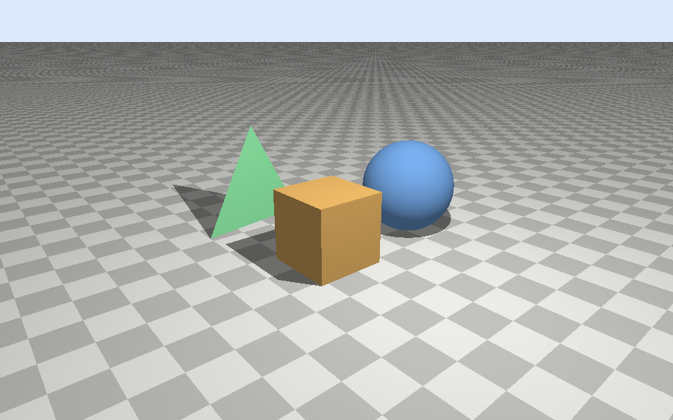

# LumaCore

**Status:** Milestone 3 complete (87 unit tests). Next: Milestone 4 (multithreaded execution).


LumaCore is an educational C++17 engine that computes direct illuminance (lux) from point light
sources on a measurement grid inside a 3D room, with ray-cast shadows. The engine is exposed as a
native Windows DLL with a C API and is used from C# (.NET Framework 4.8) through P/Invoke.

It is not a commercial lighting simulator. See [docs/physics.md](docs/physics.md) for the
model (E = I·cos θ / r²), its assumptions and limits, and how each part is verified.

## Requirements

- Visual Studio 2022 Build Tools with the "Desktop development with C++" workload (MSVC x64)
- CMake 3.24 or later
- .NET SDK 8 (builds the net48 projects; Milestone 5)
- Python 3.12 with numpy and matplotlib (visualization; Milestone 6)

## Build and test

```
cmake --preset msvc
cmake --build --preset msvc-release
ctest --preset msvc-release
```

GoogleTest is downloaded automatically at configure time (pinned to v1.15.2).

## Seeing the results

**Lux heatmap of a room.** The CLI runs a scenario and writes a CSV; the Python script turns
it into an isolux plot:

```
build\bin\Release\lumacore_cli.exe office
python tools\heatmap.py results\office.csv
start results\office.png
```

Scenarios: `office` (6 × 4 × 3 m, six 800 cd luminaires, a cabinet, a partition and a pendant
sphere) and `single` (one 1000 cd source; the CLI also prints the error against the closed-form
answer). Options: `--cell <m>` (grid spacing, default 0.05), `--border <m>` (excluded wall band,
default 0.5), `--no-shadows`, `--out <file.csv>`. The console prints E_min, E_avg, E_max,
U0 and the run time.

**Unit tests, one line per test:**

```
ctest --preset msvc-release
```

**Unit tests with GoogleTest's own output** (green `[ OK ]` / red `[ FAILED ]` lines):

```
build\bin\Release\lumacore_tests.exe
build\bin\Release\lumacore_tests.exe --gtest_filter=RaySphere.*    # one suite
build\bin\Release\lumacore_tests.exe --gtest_list_tests            # list all tests
```



**Geometry demo image.** A small ray caster that uses only the geometry code (plane, sphere,
triangle mesh, shadow rays) and writes a BMP that Windows opens directly:

```
build\bin\Release\lumacore_geometry_demo.exe results\geometry_demo.bmp
start results\geometry_demo.bmp
```

Optional arguments: `[output.bmp] [width] [height]` (default 960 x 600). The console prints how
many rays hit each object, how many shadow rays were blocked, and the render time. Things to check
in the image: straight checkerboard lines (ray-plane), no cracks along the box's face diagonals
(watertight triangles), a round sphere, and shadows pointing away from the light. The demo uses
display shading only; real lux values come in Milestone 3.

## Layout

| Path | Contents |
|---|---|
| `native/include/lumacore`, `native/src` | C++ engine (static library `lumacore_core`) |
| `native/capi` | C API, the only ABI boundary (`lumacore.dll`, Milestone 5) |
| `native/tests` | GoogleTest unit tests |
| `managed/` | C# interop library, console app and tests (Milestone 5) |
| `native/apps` | `lumacore_cli` (scenario → CSV) and `lumacore_geometry_demo` (ray-cast image) |
| `tools/` | `heatmap.py` (isolux plot); benchmark plots in Milestone 6 |
| `docs/` | Plan, architecture and physics notes |

## Milestones

| # | Scope | Status |
|---|---|---|
| M1 | Repository, CMake, GoogleTest, conventions | done |
| M2 | Vector maths and ray intersections | done |
| M3 | Illuminance model, scene, sequential simulation | done |
| M4 | Multithreaded execution | planned |
| M5 | C API DLL and C# P/Invoke | planned |
| M6 | Benchmarks, heatmaps, documentation | planned |
| M7 | Optional CUDA and OpenGL | optional |

The full plan with acceptance criteria is in [docs/plan.md](docs/plan.md).
