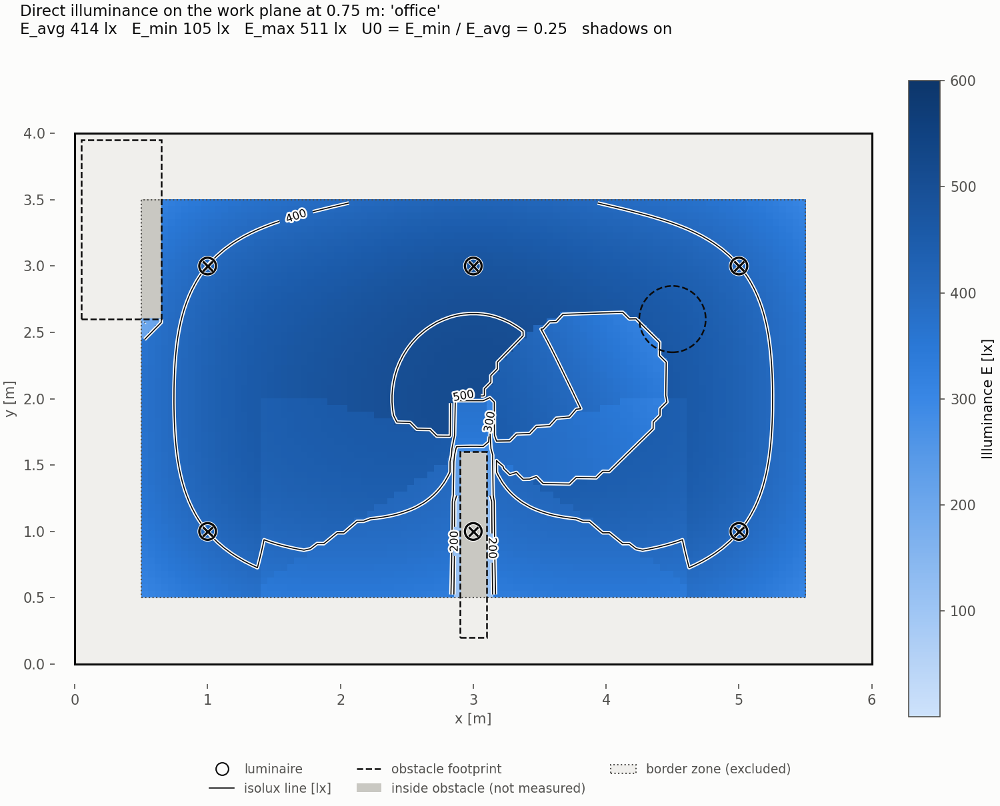

# LumaCore

A C++17 engine that computes **direct illuminance (lux)** from point light sources on a
measurement grid inside a 3D room, with ray-cast shadows. It runs sequentially or on all CPU
cores, and it is exposed as a native Windows DLL with a C API that a **C# (.NET Framework 4.8)**
application calls through P/Invoke.

It is an educational engine, not a commercial lighting simulator: direct light only, isotropic
sources, hard shadows. [docs/physics.md](docs/physics.md) states the model, its assumptions and
its limits.



*A 6 × 4 m office with six 800 cd luminaires, a cabinet, a partition and a pendant globe. Values
are on the 0.75 m work plane, with the 0.5 m border zone excluded. E_avg 414 lx, U0 = 0.25.*

## Highlights

| | |
|---|---|
| **Verified numerics** | Illuminance matches the closed form I·h/(h²+d²)^{3/2} to a relative 6×10⁻¹⁶. Flux through a square matches I·Ω (exact solid angle) to within 10⁻⁴. Every ray-primitive intersection is tested at its edge cases and with seeded randomized property tests. |
| **Parallel and deterministic** | `ThreadedExecutor` reaches **8.5× on 12 cores and 9.9× on 24 threads** (Ryzen 9 7900), and its output is **bit-identical** to the sequential run for any thread count. [Benchmarks](docs/benchmarks.md) |
| **Clean native/managed boundary** | A plain C API (13 functions, fixed-width types, opaque handle, caller-owned buffers, no exceptions across the boundary). The C# side uses a `SafeHandle` and turns native errors into exceptions. C++ and C# produce **exactly equal** grids. [Interop](docs/interop.md) |
| **Tested and reproducible** | 102 C++ tests (GoogleTest) and 14 C# tests (xUnit). One script builds and verifies everything from a clean checkout in about 40 s. No warnings at `/W4 /WX`. |

## Quick start

Requirements (Windows 10/11, x64):

- Visual Studio 2022 Build Tools with **Desktop development with C++** (MSVC, Windows SDK)
- CMake 3.24 or later
- .NET SDK 8 or later (it builds the .NET Framework 4.8 projects; no Visual Studio IDE needed)
- Python 3 with `numpy` and `matplotlib` (`pip install -r tools/requirements.txt`)

Build, test and verify everything, then open the plots:

```powershell
powershell -ExecutionPolicy Bypass -File scripts\build_all.ps1 -Clean -Bench
start results\office.png
```

The script stops at the first failure. It runs the native build and tests, the managed build and
tests, the C++ CLI and the C# console, checks that their results are identical, and draws the
heatmaps and the benchmark chart.

## Architecture

```
math → geometry → lighting / scene → simulation → parallel → lumacore.dll (C API) → C# (P/Invoke)
```

- `native/` is a static C++ library (`lumacore_core`), the C API DLL (`lumacore.dll`), the tests,
  the CLI, the benchmark and a geometry demo.
- `managed/` is `LumaCore.Interop` (P/Invoke and an idiomatic C# API), `LumaCore.Console`, and the
  xUnit tests.
- Every executor calls one shared per-row kernel, so the sequential executor is the reference for
  all the others.

Diagrams, design decisions and their alternatives: [docs/architecture.md](docs/architecture.md).

Using it from C#:

```csharp
using (var scene = new LightingScene())
{
    scene.SetRoom(6, 4, 3);
    scene.AddPointLight(new Vec3(3, 2, 2.8), 800.0);       // position [m], intensity [cd]
    scene.AddBox(new Vec3(2.9, 0.2, 0), new Vec3(3.1, 1.6, 1.6));
    var grid = MeasurementGrid.Horizontal(0.5, 0.5, 5.5, 3.5, 0.75, 100, 60);
    SimulationResult r = scene.Simulate(grid);              // all cores, shadows on
    Console.WriteLine($"E_avg {r.AvgLux:F0} lx, U0 {r.UniformityU0:F2}");
}
```

## Running the pieces

**Lux heatmap of a room (C++):**

```powershell
build\bin\Release\lumacore_cli.exe office              # or: single
python tools\heatmap.py results\office.csv
```

Options: `--cell <m>` (grid spacing, default 0.05), `--border <m>` (excluded band along the walls,
default 0.5), `--no-shadows`, `--threads <n>` or `--sequential`, `--out <file.csv>`. The `single`
scenario also prints the error against the closed-form solution.

**The same calculation from C# through the DLL:**

```powershell
managed\LumaCore.Console\bin\Release\net48\LumaCore.Console.exe --csv results\office_csharp.csv
python tools\compare_grids.py results\office.csv results\office_csharp.csv
```

**Multithreading benchmark:**

```powershell
build\bin\Release\lumacore_bench.exe                     # fails if any result is not bit-identical
python tools\plot_bench.py results\bench.csv
```


**Geometry demo.** A ray-cast image built only from the intersection code:

```powershell
build\bin\Release\lumacore_geometry_demo.exe results\geometry_demo.bmp
```

**Tests only:**

```powershell
cmake --preset msvc
cmake --build --preset msvc-release
ctest --preset msvc-release
dotnet build managed\LumaCore.sln -c Release
dotnet test managed\LumaCore.sln -c Release --no-build
```

## Repository layout

| Path | Contents |
|---|---|
| `native/include/lumacore`, `native/src` | C++ engine: math, geometry, lighting, scene, simulation, parallel |
| `native/capi` | C API, the only binary boundary (`lumacore.dll`) |
| `native/tests` | GoogleTest unit, property, concurrency and C API tests |
| `native/apps`, `native/bench` | `lumacore_cli`, `lumacore_geometry_demo`, `lumacore_bench`, shared scenarios |
| `managed/` | `LumaCore.Interop`, `LumaCore.Console`, `LumaCore.Interop.Tests` |
| `tools/` | `heatmap.py`, `plot_bench.py`, `compare_grids.py` |
| `scripts/build_all.ps1` | build and verify everything |
| `docs/` | [architecture](docs/architecture.md), [physics](docs/physics.md), [interop](docs/interop.md), [benchmarks](docs/benchmarks.md), [plan](docs/plan.md) |

## Limitations and next steps

- **Isotropic sources.** Real luminaires have a direction-dependent intensity I(C, γ). The next
  step is reading EULUMDAT (.ldt) or IES photometric files.
- **Direct light only.** No inter-reflections, so values are below those in a real room with
  light-coloured surfaces.
- **Brute-force occlusion.** Every shadow ray tests every primitive. A bounding-volume hierarchy
  would make large scenes fast; the benchmark is ready to measure it before and after.
- **No GPU backend yet.** A CUDA executor would plug into the same `IExecutor` interface, with
  results compared against the CPU reference.
- **Deployment.** `lumacore.dll` needs the Visual C++ 2015–2022 runtime (x64) on machines without
  Visual Studio.

## Development

Built milestone by milestone (plan and acceptance criteria in [docs/plan.md](docs/plan.md)):

| # | Scope | Status |
|---|---|---|
| M1 | Repository, CMake, GoogleTest, conventions | done |
| M2 | Vector maths and ray intersections | done |
| M3 | Illuminance model, scene, sequential simulation | done |
| M4 | Multithreaded execution and benchmark | done |
| M5 | C API DLL and C# P/Invoke | done |
| M6 | Build-and-verify script, architecture and documentation | done |
| M7 | Optional: EULUMDAT photometry, BVH, CUDA, OpenGL | not started |

Coding conventions and project rules: [CONTRIBUTING.md](CONTRIBUTING.md).
