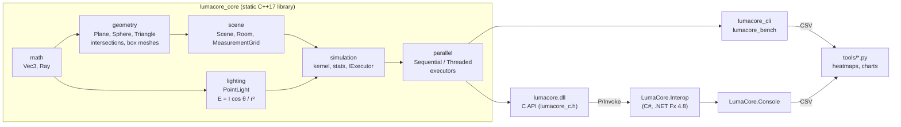

# Architecture

## Layers

Dependencies point one way only. The engine knows nothing about the C API, the C API knows
nothing about C#, and the maths and geometry layers do no I/O and no threading.



| Module | Responsibility | Key types / files |
|---|---|---|
| math | value types and pure functions; `constexpr` where possible | `Vec3`, `Ray` (unit-direction invariant), `constants.hpp` (all tolerances in one place) |
| geometry | primitives with validated construction; ray queries returning `std::optional<Hit>`; acceleration | `intersection.cpp`: plane, sphere (cancellation-free roots), Möller–Trumbore triangle; `bvh.cpp`: bounding volume hierarchy |
| lighting | the photometric model; luminaire light distributions | `point_illuminance()`, `PointLight`, `Photometry` + EULUMDAT reader |
| scene | owns lights and occluders by value; any-hit occlusion; inside-solid test | `Scene`, `Room`, `MeasurementGrid` |
| simulation | one per-row kernel shared by every executor; statistics | `compute_rows()`, `simulate()`, `simulate_into()`, `IExecutor` |
| parallel | how rows are scheduled | `SequentialExecutor`, `ThreadedExecutor` |
| capi | the only binary boundary: argument checks, type conversion, exceptions → status codes | `lumacore_c.h`, `lumacore_c.cpp` |
| managed | idiomatic C# API over the C API | `LightingScene`, `SceneHandle`, `NativeMethods` |

## One calculation, end to end

What happens when C# code calls `scene.Simulate(grid)`:

```mermaid
sequenceDiagram
    participant App as C# app
    participant LS as LightingScene (C#)
    participant DLL as lumacore.dll (C API)
    participant Eng as engine (C++)
    App->>LS: Simulate(grid, options)
    LS->>LS: allocate double[nx*ny], convert grid/options to blittable structs
    LS->>DLL: lc_simulate(handle, &grid, &options, lux[], count, &stats)
    Note over LS,DLL: marshaller pins lux[]; SafeHandle keeps the scene alive during the call
    DLL->>DLL: check args, build MeasurementGrid (invalid → std::invalid_argument)
    DLL->>Eng: simulate_into(job, executor, lux, count)
    Eng->>Eng: scene.validate()
    par rows handed out by an atomic counter
        Eng->>Eng: worker 1: compute_rows(…)
        Eng->>Eng: worker N: compute_rows(…)
    end
    Eng-->>DLL: RunSummary {stats, elapsed}
    DLL-->>LS: LC_OK (or status + thread-local message)
    LS-->>App: SimulationResult, or LumaCoreException(status, message)
```

## Design decisions

| Decision | Why | Alternative considered |
|---|---|---|
| C API between C++ and C#, not C++/CLI or exported classes | stable ABI, works with any caller (C#, Python ctypes, C), keeps the engine pure C++ | C++/CLI: Windows-only and ties the engine to .NET |
| One shared `compute_rows()` kernel, light contributions summed in scene order | every executor gives bit-identical results, so the sequential executor is the oracle for all others | per-executor loops: results could drift in the last bits |
| Dynamic row scheduling through an atomic counter | rows behind obstacles cost more (shadow rays); static splits would leave threads idle | static partition: simpler, worse balance |
| Workers share the scene by `const&` and write disjoint rows | no locks and no races by construction (MSVC has no ThreadSanitizer, so it is designed out and tested by bit-equality) | locks or atomics per cell: slower and harder to reason about |
| `double` everywhere on the CPU | lux values are summed over many lights; tests check to 1e-12 relative | `float`: kept for a possible GPU backend, where FP64 is slow |
| Points inside obstacles are NaN and excluded from statistics | a work plane cutting through furniture is not a measurable surface; including those points made U0 meaningless | 0 lx: silently wrong statistics |
| Occlusion through a bounding volume hierarchy, brute force kept as the reference | furniture brings thousands of triangles; the BVH is 159× faster at 12,000 triangles, and a conservative box test plus the same triangle test in the leaves makes results bit-identical to brute force (tested) | brute force only: simple, but 0.9 s per frame at 48,000 triangles; a uniform grid: worse for uneven scenes |
| Invalid input → exception at construction; hot path `noexcept` | objects are valid once built, so the inner loops need no checks | error codes everywhere: noisier code |

## Error handling across layers

| Layer | Invalid input | Out of memory | Bug / unexpected |
|---|---|---|---|
| C++ engine | `std::invalid_argument` thrown at construction or validation | `std::bad_alloc` | `std::exception` |
| C API | `LC_ERR_NULL_ARGUMENT`, `LC_ERR_INVALID_ARGUMENT`, `LC_ERR_BUFFER_TOO_SMALL` | `LC_ERR_OUT_OF_MEMORY` | `LC_ERR_INTERNAL` |
| C# | `ArgumentException` for managed checks, `LumaCoreException(Status, message)` for native ones | `LumaCoreException(OutOfMemory)` | `LumaCoreException(Internal)` |

## Testing strategy

| Level | What | Count |
|---|---|---|
| Unit (C++) | vector identities, every intersection edge case, illuminance against closed forms, grid, scene, statistics | 87 |
| Property (C++) | seeded random checks: Lagrange identity, hit points on surfaces, watertight boxes, superposition | part of the 87 |
| Concurrency (C++) | threaded = sequential, bit for bit, for 1–64 threads; repeated runs; every cell written once | 5 |
| C API (C++) | every export through the DLL: null and invalid arguments, buffers, per-thread errors | 10 |
| Photometry (C++) | EULUMDAT parsing, all symmetry types, interpolation, errors with line numbers, rotation, flux of the sample files, illuminance against closed forms | 13 |
| Interop (C#) | struct layouts, closed-form values through P/Invoke, errors, dispose, 2000 create/destroy cycles | 14 |
| End to end | C++ CLI vs C# console: identical grids (`tools/compare_grids.py`) | 1 script |
| BVH (C++) | any-hit = brute force for 20,000 random rays, rays at corners and edges, axis-parallel rays; whole simulation bit-identical with and without the tree | 6 |
| Watertightness (C++) | rays exactly through a quad's shared diagonal always hit; a box blocks the ray through its face diagonals | 2 |
| WebAssembly (Node.js) | closed form, error values, sample-file flux, office grids vs native C++ | `tools/wasm_check.mjs` |
| Web engine and geometry (Node.js) | energy conservation in a closed room (isotropic, EULUMDAT), shadows and rotation on surfaces, the furniture rule on 100,000+ points, solid boxes, tessellation and merged vertices, scenes inside their rooms, furnished-office regression values, every dark point explained | `tools/web_check.mjs`, 19 checks |
| **Total** | | **123 C++ + 14 C# + Node.js checks** |

Everything runs with one command: `scripts\build_all.ps1 -Clean`.
