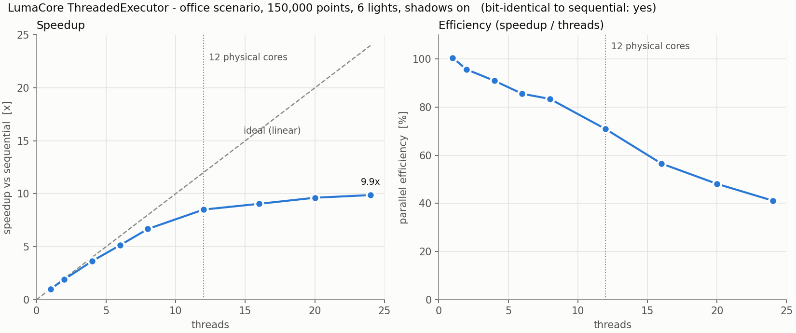

# Benchmarks

## Setup

- CPU: AMD Ryzen 9 7900, 12 cores / 24 hardware threads (SMT), Windows 11
- Build: MSVC 19.44 (VS 2022 Build Tools 17.14), Release (`/O2`), x64
- Scene: `office` scenario: 6 luminaires, 25 occluder primitives (2 boxes = 24 triangles, 1 sphere),
  shadows on, 0.5 m border zone excluded
- Method: `lumacore_bench`. Per configuration: 1 warm-up run, then the median of N timed runs. Only the
  executor run is timed. Every threaded result is compared **bit for bit** with the sequential
  result, and the benchmark fails if any differ.

Reproduce:

```
build\bin\Release\lumacore_bench.exe                      # 1 cm cells, 150,000 points, 7 runs
build\bin\Release\lumacore_bench.exe --cell 0.005 --reps 5 --out results\bench_fine.csv
python tools\plot_bench.py results\bench.csv
```

## Results



| Threads | 150k points: median | Speedup | Efficiency | 600k points: median | Speedup |
|---:|---:|---:|---:|---:|---:|
| sequential | 93.3 ms | 1.00× | | 366.5 ms | 1.00× |
| 1 | 92.9 ms | 1.01× | 101 % | 365.5 ms | 1.00× |
| 2 | 48.8 ms | 1.91× | 96 % | 188.3 ms | 1.95× |
| 4 | 25.7 ms | 3.64× | 91 % | 102.1 ms | 3.59× |
| 8 | 14.0 ms | 6.67× | 83 % | 56.3 ms | 6.51× |
| 12 | 11.0 ms | 8.50× | 71 % | 42.7 ms | 8.58× |
| 16 | 10.3 ms | 9.05× | 57 % | 39.9 ms | 9.20× |
| 24 | 9.5 ms | 9.87× | 41 % | 38.2 ms | 9.61× |

All threaded results were bit-identical to the sequential result.

## Interpretation

- **Close to linear up to 8 threads** (83–96 % efficiency): the work splits into independent rows,
  there are no locks, and the shared atomic row counter is touched only about 8 times per thread.
- **The curve bends at 12 threads**, the number of physical cores. Going from 12 to 24 threads adds
  only about 16 %. With SMT, two hardware threads share one core's floating-point units, and this
  workload is almost pure double-precision arithmetic (ray-triangle tests).
- **Overhead is not the limit.** A 4× larger grid gives the same curve, so thread start-up and
  scheduling costs, which do not grow with the grid, are not what reduces efficiency.
- **Likely remaining cause (not measured):** a single active core runs at a higher boost clock than
  all 12 cores together under this 65 W CPU's power limit, so the sequential baseline runs on a faster
  core than each of the 12 threads. Confirming this would need clock-frequency monitoring during the
  runs.

## Occlusion: brute force vs bounding volume hierarchy

Every shadow ray asks "is anything between this point and the lamp?". Testing every triangle costs
time proportional to the triangle count; a bounding volume hierarchy (`TriangleBvh`: median split
along the longest centroid axis, at most 4 triangles per leaf) skips whole groups of triangles a
ray cannot hit.

Setup: the office plus N random boxes (12 triangles each) **below the work plane**, all 24 threads,
5 cm grid (6,000 points), 6 lamps. Every BVH result is compared bit for bit with brute force.

| Triangles | Brute force | BVH | BVH build | Speedup |
|---:|---:|---:|---:|---:|
| 24 | 1.1 ms | 0.9 ms | 0.0 ms | 1.2× |
| 1,224 | 20.3 ms | 1.1 ms | 0.3 ms | 17.8× |
| 12,024 | 209.7 ms | 1.3 ms | 3.2 ms | **158.5×** |
| 48,024 | 910.9 ms | 3.3 ms | 14.1 ms | **273.9×** |

All results identical. Brute force grows linearly with the triangle count; the BVH barely grows.

**Why the clutter is below the work plane.** The first version placed boxes up to 2 m high. Then
almost every shadow ray was blocked, and an any-hit search stops at the first blocker, so brute
force rarely tested all triangles: it even got *faster* from 12,000 to 48,000 triangles. In a real
furnished room most light reaches the desks, so most shadow rays are unblocked and must be checked
against everything. That is the case the BVH is for, and the case measured above.

**In the browser** (WebAssembly, one thread, measured in Node.js 24 with the same build): the
furnished office (4,904 shadow triangles, 14 luminaires, 14,000 points at 5 cm) takes a median of
**51 ms** per recalculation while a luminaire is dragged, about 20 updates per second. The engine
keeps the BVH while only lights change; when furniture moves it rebuilds it in **2.7 ms**. The 10 cm
grid option has a quarter of the points and is correspondingly faster.
